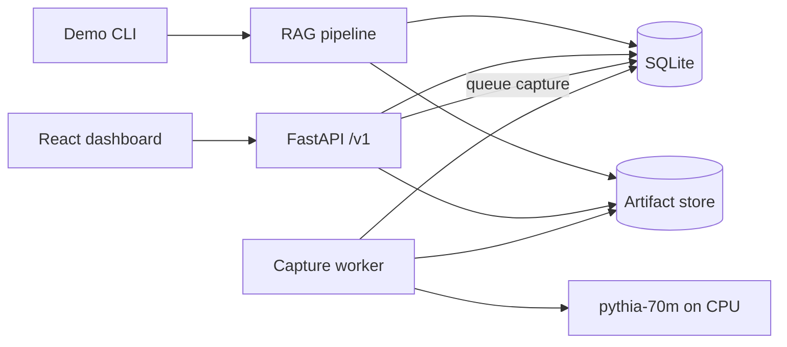

# AI Black Box Lab

**See what an AI system did, and what was happening inside the model when it did it.**

AI Black Box Lab is a local research tool that links two things that are usually kept apart:

- **Application tracing:** which document a retrieval step picked, which model call used it, and what came out.
- **Model internals:** the numbers inside the model during that call, read safely and tied back to the same run.

Everything runs on your own machine. There is no cloud account, no paid API and no GPU requirement.

> **Status: early research software.** Phases 1 to 3 are done (tracing, an evidence store, and neural capture). SAE feature analysis, controlled experiments and report export are planned. See [Roadmap](#roadmap).

## The problem it explores

A document-grounded assistant gives a wrong answer after it was handed an outdated source. Today you can see the retrieved document and the answer, but not whether the model ignored the right evidence or never received it. This project builds the pieces to answer that, one verified step at a time: open a run, follow its trace to the exact document version and model call, read selected internal signals, and keep clear which statements are observed, which are measured, and which are only guesses.

The built-in demo is a small, controlled version of that story. Ten synthetic "reimbursement cap" questions each have a current and a superseded document. You can make the retriever return the stale one, then inspect what happened.

## What you can do today

| Capability | What it gives you |
|---|---|
| **Traced runs** | A run, its model invocation, the retrieved document version (with SHA-256) and OpenTelemetry/OpenInference spans, all stored in a local SQLite file and linked by IDs |
| **Run viewer** | A web page showing the answer, whether it was correct, the exact document version used, the invocation, and the span timeline |
| **Evidence store** | Documents, prompts and tensors saved as content-addressed files that are re-hashed on every read, so tampering is detected and shown |
| **AI Trace IR events** | A versioned, validated event record (schema in [`packages/trace_schema`](packages/trace_schema/ai_trace_ir_v0.1.json)) that labels each fact as observed, measured, inferred or intervened |
| **Neural capture** | Residual-stream activations from a real model ([pythia-70m-deduped](https://huggingface.co/EleutherAI/pythia-70m-deduped)), captured by read-only hooks in a background worker and shown in a layer-by-position table |
| **Safety by default** | Prompts, answers and token IDs are stored only if you opt in per run. Everything binds to localhost |

## How it fits together



- The **demo pipeline** retrieves a fixture document, calls a model (a built-in deterministic stand-in by default, or pythia from the CLI) and writes the run, spans, events and artifacts.
- The **API** serves run details, artifact checks, capture jobs and measurement summaries. It never runs a model inside a request.
- The **worker** is a separate process that replays a stored run through the real model, checks that its hooks changed nothing, and stores the tensors.
- The **dashboard** only talks to the documented `/v1` API.

## Quick start

You need [uv](https://docs.astral.sh/uv/) and Node.js 20 or newer. Commands below use a bash-style shell.

```bash
git clone https://github.com/aum2606/ai-blackbox.git
cd ai-blackbox

uv sync                                  # Python 3.12 is installed for you
npm ci --prefix apps/dashboard
uv run alembic upgrade head              # creates .local/blackbox.db
```

Start the API and the dashboard in two terminals:

```bash
uv run uvicorn blackbox_api.app:app_from_env --factory --host 127.0.0.1 --port 8000
npm run dev --prefix apps/dashboard
```

Create a run where retrieval returns the outdated document, then open the printed link:

```bash
uv run python -m demo_rag --case case_0007 --fault stale_version --capture-content
```

You should see the answer `500 units` marked incorrect (the current policy says `800 units`), the superseded document version with its checksum, the model invocation, and the trace. Run the same command with `--fault none` to see the correct answer.

### Optional: capture neural activations

This needs about 200 MB for PyTorch (CPU) and a 166 MB one-time model download, and roughly 1 GB of free RAM.

```bash
uv sync --group neural
uv run python -m demo_rag --case case_0007 --fault stale_version --capture-content --model pythia-70m-deduped
```

Then queue a capture for the printed invocation and run the worker. The full steps are in the [Phase 3 runbook](docs/runbooks/phase3_neural.md).

## API at a glance

| Endpoint | Purpose |
|---|---|
| `POST /v1/runs` | Create a demo run (`case_id`, `retrieval_fault`, `capture_content`) |
| `GET /v1/runs/{id}` | Answer, correctness, retrieved document version, invocations, spans |
| `GET /v1/invocations/{id}` | Model identity, hashes and links for one model call |
| `GET /v1/artifacts/{id}` | Artifact metadata and a fresh checksum verification (bytes are never served) |
| `POST /v1/invocations/{id}/captures` | Validate and queue a neural capture |
| `GET /v1/captures/{id}` | Job status and how the replay compared to the original |
| `GET /v1/invocations/{id}/measurements` | Measured activation summaries, each linked to its verified tensor |
| `GET /v1/health` | Liveness |

Errors always have the shape `{"error": {"code", "message", "request_id"}}`. The OpenAPI contract is checked in at [`tests/contract/openapi_v1.json`](tests/contract/openapi_v1.json).

## How to read the results

The project is strict about what a number means. Every result belongs to one class, and the UI and API say which:

| Class | Meaning | Example |
|---|---|---|
| `observed` | Something the system directly saw | The retriever returned document version 1 |
| `measured` | A number read from the model | Layer 3 activation norm at position 32 |
| `inferred` | An interpretation | "This feature may mean X" |
| `intervened` | The result of a controlled change | Patching site S changed metric M |

Activation sizes are **not** an explanation of the model's reasoning. Replays are teacher-forced and labelled approximate, never exact.

## Repository layout

```text
apps/
  api/            FastAPI service (/v1)
  dashboard/      React + Vite + TypeScript run viewer
  demo_rag/       Stale-document demo: retriever, backends, pipeline, CLI
packages/
  trace_schema/   AI Trace IR event schema
  trace_ingest/   OpenTelemetry spans and events into SQLite
  run_registry/   Runs, invocations, capture jobs, measurements
  evidence_store/ SQLite engine and checksummed artifact store
  instrumentation/  Model adapter, hooks and capture plans
workers/experiment_worker/   Background capture worker
experiments/stale_document/  Frozen synthetic fixtures with checksums
migrations/       Alembic database migrations
docs/             Architecture, decisions (ADRs), protocols, runbooks
tests/            unit, integration, contract, e2e and neural tests
```

## Development

```bash
uv run ruff format --check . && uv run ruff check .
uv run pytest                  # default suite: no model download needed
uv run pytest -m neural        # needs `uv sync --group neural` and the cached model
npm run lint --prefix apps/dashboard && npm run build --prefix apps/dashboard
```

The default test suite does not need PyTorch. `mypy` does, because it type-checks the model adapter; the exact command is in the [Phase 1 runbook](docs/runbooks/phase1_demo.md).

Contributors, human or AI, must follow [`rules_v1.1.md`](rules_v1.1.md): build only what is needed, keep claims tied to evidence, and report test results honestly.

## Documentation

- [Architecture design document](docs/architecture/AI_Black_Box_Lab_Architecture_v1.1_Free_Tier.md) and [decision records](docs/adr/README.md)
- Runbooks: [Phase 1: tracing demo](docs/runbooks/phase1_demo.md) · [Phase 2: evidence store](docs/runbooks/phase2_evidence.md) · [Phase 3: neural capture](docs/runbooks/phase3_neural.md)
- [Research protocol for the stale-document benchmark](docs/research-protocols/stale_document_v1.md)
- [Model compatibility report](docs/compatibility/pythia-70m-deduped.md)

## Cost, privacy and limits

- **Free to run:** no cloud services, paid APIs, or accounts. Optional free notebook use is planned, never required.
- **Private by default:** the API binds to `127.0.0.1`. Prompt, answer and token IDs are stored only when you pass `--capture-content`. Demo data is synthetic.
- **Not production software:** there is no authentication, so do not expose it to a network. Retention and deletion of stored artifacts are not enforced yet.
- **Small model, small claims:** pythia-70m often answers the demo questions wrongly. Phase 3 shows that capture works, not that the model "knows" something.
- **Windows and Linux/macOS:** developed and tested on Windows 11; other platforms are untested.

## Roadmap

| Phase | Goal | State |
|---|---|---|
| 1 | Observable RAG demo with traces | Done (`v0.1-traces`) |
| 2 | AI Trace IR and checksummed evidence store | Done (`v0.2-evidence`) |
| 3 | Diagnostic neural capture | Done (`v0.3-neural`) |
| 4 | Sparse autoencoder (SAE) feature exploration | Planned |
| 5 | Controlled clean/corrupt experiments with controls | Planned |
| 6 | Combined research debugger and report export | Planned |
| 7 | Evaluation and hardening | Planned |

## License

No license file has been added yet, so no reuse rights are granted for now.
