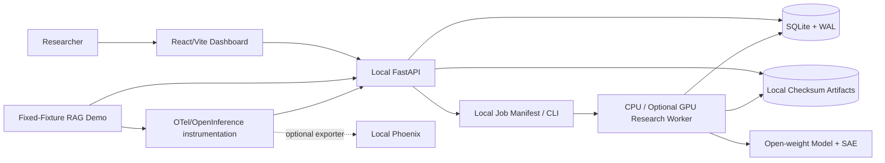
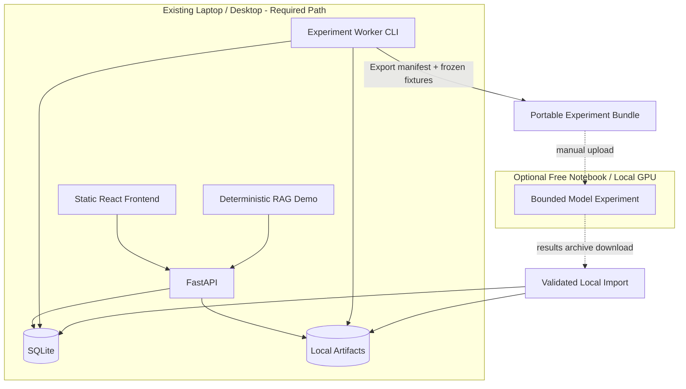
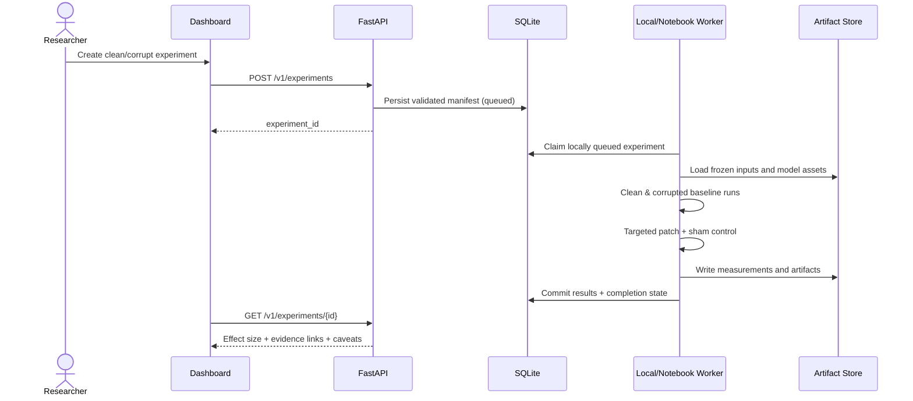

# AI Black Box Lab

**Architecture Design Document (ADD) · Version 1.1 · 17 November 2026**  
**Status:** Proposed; implementation decisions in this document are defaults until validated by Phase 0 compatibility and performance spikes.  
**Architecture owner:** Project maintainer.  
**Primary implementation:** Python; TypeScript for the dashboard; Rust only after measured need.  
**Hard constraint:** ₹0 incremental spend on paid hosting, managed databases, model APIs, cloud GPUs, and storage. All MVP functionality must work locally without an external account.

> **North-star scenario:** A document-grounded AI assistant gives an incorrect answer after receiving an outdated source. A researcher opens one run, sees its retrieval and model-call trace, inspects selected neural signals, runs a controlled intervention, and exports an evidence-backed diagnosis that distinguishes observation, interpretation, and causal evidence.

## Executive decision summary

| Decision | Free-first choice | Rationale |
|---|---|---|
| Budget | **₹0 incremental paid service charges**; existing device/internet/electricity are not priced as zero | No required subscriptions, credit cards, or surprise bills |
| Primary language | Python 3.11+ (pin supported version in Phase 0) | Mature PyTorch/research ecosystem |
| Dashboard | TypeScript + React/Vite static SPA | Smaller local footprint; no SSR requirement |
| Rust | Deferred; only after profiling | Avoid implementation overhead |
| Architecture | Local modular monolith + separate CLI experiment worker | No cloud orchestration required |
| Execution tracing | OpenTelemetry/OpenInference in-process plus local trace persistence | Standard semantics without mandatory tracing server |
| Tracing viewer | Built-in minimal run viewer; Phoenix optional local development tool | No continuously running extra service required |
| Neural interface | TransformerLens/NNsight/PyTorch hooks behind adapter | Research flexibility |
| SAE | Compatible pretrained SAELens/Gemma Scope asset, if locally executable | Avoid expensive SAE training |
| Metadata | **SQLite (WAL + foreign-key enforcement)** | Zero service cost and simple backup |
| Tensor artifacts | Local directory with checksums and quotas | No object-storage service |
| Analytics | Parquet + DuckDB as optional offline dependency | Local analysis without server |
| Models | Tiny CPU smoke model first; larger compatible open-weight model only if resources permit | Preserve no-GPU progress |
| GPU research | Local GPU where available; **optional** free Colab/Kaggle notebook export/import | No guaranteed notebook quota or uptime |
| Deployment | localhost processes; optional Docker Compose for convenience | No mandatory paid hosting or container stack |
| CI | Local pre-commit/test commands; optional free GitHub Actions within account limits | Zero paid CI requirement |

**Design principle:** An activation is a *measurement*; a natural-language feature label is an *interpretation*; an observed change under controlled intervention is *experimental evidence*. These do not constitute a complete internal reasoning transcript.

**Build principle:** Local, offline-capable baseline first. Optional convenience services may be enabled later, but a task must not fail solely because a free cloud quota expires.

**Change in v1.1:** Replaces the v1.0 PostgreSQL, mandatory Phoenix/Compose, cloud-oriented worker and object-store defaults with SQLite, local artifacts, built-in trace viewing, offline experiment bundles, and budget enforcement.

---

# 1. Scope, objectives, and boundaries

## 1.1 Problem statement

Traditional LLM observability can show inputs, retrieved documents, tool calls, and outputs, but usually does not connect those events to the model's internal representations. Mechanistic interpretability notebooks can inspect activations, but usually lack an application-level execution timeline, durable run metadata, privacy controls, and reproducible diagnostic workflows. This project links both layers through trace identifiers, model-invocation provenance, an experiment engine, and an evidence-oriented debugger.

## 1.2 Primary goals (must have)

1. Record reproducible execution traces for a small RAG/agent demonstration.
2. Bind an observable `model_invocation_id` to a specific model revision, prompt rendering, tokenization, and forward/generation pass.
3. Capture **selected** residual stream activations and target-token logits from a supported open-weight model.
4. Encode selected activations with a compatible pretrained SAE and label descriptions as hypotheses.
5. Execute clean/corrupt counterfactuals and activation patching with negative controls.
6. Persist full provenance: environment, model, tokenizer, dataset, seed, hooks, SAE, code revision, and tensor checksums.
7. Explore an execution timeline, activation view, and experiment results through a single web interface.
8. Export a machine-readable and human-readable diagnostic report with limitations.

## 1.3 Non-goals for v1

- Reconstructing an exact natural-language transcript of internal model computation.
- Interpreting inaccessible internals of hosted closed-weight APIs.
- Supporting every model architecture or arbitrary model code in the first release.
- Full multi-tenant production SaaS, organization billing, or Kubernetes.
- Training large SAEs from scratch, training foundation models, or real-time full-circuit tracing of every request.
- Automatic declarations of causal explanations from correlations or heatmaps.
- Running untrusted arbitrary experiment Python supplied by web users.

## 1.4 Explicit user journeys

**Researcher:** select an incorrect answer → inspect trace → find model invocation → view token/layer measurements → create paired experiment → read controls and effect sizes → export report.

**Developer:** instrument a toy RAG application → view tool and retrieval errors → compare executions under known injected faults.

**Maintainer:** verify model adapter compatibility, enforce retention policy, inspect failed jobs, reproduce experiments from pinned manifests.

## 1.5 Success criteria for first demonstrator

- One complete stale-document experiment linked from answer to source document and model invocation.
- At least one measurable neural intervention; baseline and negative-control runs included.
- Re-execution from stored configuration produces results within documented numerical tolerances, or non-reproducibility is reported transparently.
- No tensors stored inline in relational tables and no prompt/body capture without explicit enablement.
- A new developer can run the core stack and tiny-model tests locally at no paid-service cost; GPU work is optional and must have a documented manual free-notebook or local-GPU route.

---

# 2. Scientific model and evidence rules

## 2.1 Evidence taxonomy

| Category | Meaning | Examples | Safe claim |
|---|---|---|---|
| `observed` | Direct runtime event | Tool result, retrieved document ID, emitted token | "The tool returned document D" |
| `measured` | Instrumented numerical signal | Logit difference, residual activation, SAE value | "Feature F had activation X" |
| `inferred` | Interpretation or association | Candidate label, feature hypothesis | "This signal may represent Y" |
| `intervened` | Result of controlled modification | Patched-layer effect, document replacement | "Replacing A changed metric M by Δ" |

Every UI panel and exported finding must display its evidence class. Do not display unsupported causal arrows. In graph mode, use **solid edges** only for measured intervention relationships with attached experiment IDs; use **dashed edges** for hypotheses or correlations.

## 2.2 Research questions

- **RQ1 — Diagnostic accuracy:** Does trace + neural evidence identify known injected failure mechanisms more accurately than trace-only analysis?
- **RQ2 — Causal specificity:** Can interventions isolate model components with effects beyond matched random controls?
- **RQ3 — Stability:** Do candidate SAE feature explanations and intervention effects survive prompt paraphrases and new examples?
- **RQ4 — Practicality:** What are the additional latency, memory, storage, and investigator-time costs?

## 2.3 Scientific controls

All experiment protocols must define before execution: the exact target metric, clean/corrupt inputs, token alignment rule, the location/size of the intervention, a random or sham control, seed policy, number of repeats, exclusion criteria, and expected failure cases. For causal tests, do **not** change both the input document and the patched activation in the same comparison unless the factorial design is explicit. Report unsuccessful and null findings; do not filter to visually compelling examples.

---

# 3. System context and logical architecture

## 3.1 System context diagram



**Ownership:** SQLite stores event/run/experiment metadata and cross-references; activation tensors reside in content-addressed local files; the application owns a minimal trace viewer. Phoenix is an **optional** secondary visualizer, not a critical dependency.

## 3.2 Local and optional notebook execution boundaries



**Default worker:** Run a local subprocess/CLI and persist job state in SQLite. The API must not perform heavy model execution on request threads. Do not add Redis, Celery, a Kubernetes cluster, or a remote database in the MVP.

**Notebook integration:** An **offline handoff**, not a live service: export a versioned manifest, frozen synthetic inputs, checksums, dependency lock/requirements and a notebook runner; execute within the notebook's permitted limits; download a result bundle and validate its hashes/model metadata before importing into local SQLite. Never require the notebook to connect to the developer's local database or expose a localhost port to the internet.

**Availability rule:** Free GPU sessions and quotas vary and may be unavailable. The platform must support CPU-based schema/tracing/capture tests and mark large-model research experiments as `blocked_resource` or `not_run` instead of silently buying compute or fabricating outcomes.

## 3.3 Major modules and ownership

| Module | Responsibility | Explicit exclusions |
|---|---|---|
| `trace_ingest` | Normalize/correlate OTLP and OpenInference references | No neural tensor parsing |
| `run_registry` | Runs, invocation IDs, model revision, prompt hashes | No inference |
| `evidence_store` | Metadata, checksums, artifact manifests and signed access | No interpretation decisions |
| `instrumentation` | Model adapter, hooks, token maps, activation snapshots | No UI logic |
| `feature_analysis` | SAE loading, encode, feature scores, candidate annotations | No causal claims without experiment |
| `experiment_engine` | Manifests, intervention execution, metric calculation, controls | No arbitrary web-supplied code |
| `reporting` | Human-readable evidence summary and export | No hidden "reasoning transcription" |
| `dashboard` | Navigation, charts, compare and experimental configuration | No direct database access |

**Architectural invariants:**

1. `model_invocation_id` is a first-class ID created before a model call and included in the trace and experiment manifests.
2. Raw tensors remain separate from API-facing JSON; return previews, summarized statistics, or downloadable artifacts only with permission.
3. Research experiments are immutable once completed. Re-runs create a new attempt linked to an original experiment.
4. Instrumentation adapters must expose their supported model architectures, hook names, and numerical compatibility checks.
5. An explanation object always points to concrete evidence and discloses what is inferred.

---

# 4. End-to-end request and investigation flows

## 4.1 Normal observed AI execution

1. Dashboard or test runner creates `run_id` and root trace context.
2. Demo retriever selects a document; stores source ID, content hash, version and snapshot reference.
3. Model gateway creates `model_invocation_id` **before tokenization**.
4. Gateway freezes rendered prompt and tokenizer metadata; optionally stores a protected prompt snapshot.
5. Model runtime generates a response. OpenTelemetry records the operation and its timings.
6. Gateway stores output token IDs (when accessible), generation settings, output hash and answer references.
7. API associates the OTLP `trace_id/span_id` with the invocation record. The dashboard renders a trace summary, linking to Phoenix where useful.

**Source-of-truth warning:** If a hosted API is used for the demonstration, the trace may be complete while internal activations remain unavailable; the UI must explicitly say "neural access unavailable".

## 4.2 Diagnostic neural replay

1. Researcher selects a `model_invocation_id` and chooses `diagnostic` capture mode.
2. API checks access, model asset availability, saved prompt/token IDs, and artifact retention.
3. Worker loads the pinned model/tokenizer revision and verifies golden-prompt numerical baseline.
4. Worker re-executes deterministic token-level inference **teacher-forced on captured token IDs** where appropriate; this aligns the internal computation with previously produced tokens instead of assuming stochastic regeneration gives identical output.
5. Worker captures selected hooks and requested positions in bounded batches; tensors are moved to CPU/object storage with a checksum and dtype/shape metadata.
6. Feature adapter reads compatible tensors, computes SAE activations, and saves candidate labels with their provenance.
7. Worker publishes `measurement` and `feature` artifacts; UI updates without overstating what the features mean.

**Important:** Teacher-forced analysis reproduces computations conditional on a fixed token sequence, not necessarily the exact stochastic sampling path. Sampling decisions, KV-cache implementations, precision/quantization, and nondeterministic kernels must be recorded separately; unsupported exact replay is surfaced as a limitation.

## 4.3 Causal experiment flow



Experimental work must be idempotent: a duplicate queued request with the same manifest hash should be recognized; a retry records `attempt_id` and does not silently overwrite previous outputs.

---

# 5. Data architecture and AI Trace IR

## 5.1 Identifiers and relationships

- `run_id`: one end-user task execution.
- `trace_id`: W3C/OTLP distributed trace identifier; a run can have one or more traces.
- `span_id`: operation within a trace.
- `model_invocation_id`: a specific model request/forward/generation sequence.
- `prompt_snapshot_id`: immutable reference to the *rendered* input or its hash.
- `token_sequence_id`: exact token IDs, positional metadata, tokenizer revision.
- `measurement_id`: activation/logit/feature measurement record.
- `artifact_id`: immutable binary payload with checksum, shape, dtype, source.
- `experiment_id`: immutable manifest and logical experiment.
- `attempt_id`: one execution attempt under that experiment.
- `finding_id`: interpretation or experimentally supported finding with evidence references.

**Relationships:** `Run 1—N Invocation`; `Invocation 1—N Measurement`; `Measurement N—1 Artifact`; `Experiment 1—N Attempt`; `Finding N—N Evidence`. A trace ID can link multiple invocations via spans.

## 5.2 AI Trace IR v0.1 — event envelope

```json
{
  "schema_version": "0.1.0",
  "event_id": "01J-example-ulid",
  "event_type": "neural.activation.capture",
  "evidence_class": "measured",
  "occurred_at": "2026-11-16T08:30:00Z",
  "run_id": "run_01",
  "trace_id": "32hexchars-of-otel-trace-id",
  "span_id": "16hexchars-span-id",
  "model_invocation_id": "inv_01",
  "location": {
    "forward_pass_id": "pass_01",
    "generation_step": 4,
    "token_position": 31,
    "layer": 12,
    "hook_name": "blocks.12.hook_resid_post"
  },
  "payload": {
    "artifact_id": "art_01",
    "tensor_shape": [1, 1, 2560],
    "tensor_dtype": "float32",
    "summary": {"l2_norm": 41.2}
  },
  "provenance": {
    "model_revision": "commit-or-digest",
    "tokenizer_revision": "commit-or-digest",
    "instrumentation_version": "git-commit",
    "capture_config_hash": "sha256:..."
  }
}
```

These are illustrative IDs and numerical values. Use ordinary OpenTelemetry spans for duration-bearing model/tool operations. AI Trace IR is a **companion research record**, not a replacement for OTLP or its semantic conventions.

## 5.3 Relational schema (minimum required entities)

| Entity | Essential fields | Design notes |
|---|---|---|
| `runs` | id, task_id, started_at, status, trace_id, dataset_case_id | Root execution summary |
| `model_invocations` | id, run_id, span_id, model_id, revision, tokenizer_revision, prompt_hash, sampling_config, output_hash | Immutable identity |
| `documents` | id, corpus_id, version, sha256, artifact_id, valid_from, valid_to | Ground truth/provenance |
| `retrieval_results` | id, run_id, invocation_id, document_id, rank, score, snapshot_id | No hidden document mutations |
| `artifacts` | id, sha256, relative_path, mime_type, nbytes, dtype, shape_json, retention_until | Content-addressed local file; path constrained to artifact root |
| `measurements` | id, invocation_id, kind, layer, hook, token_position, artifact_id, summary_json | No large tensors inline |
| `feature_annotations` | id, measurement_id, sae_release, feature_id, label, labeling_method, status, evidence_refs | Labels unverified by default |
| `experiments` | id, manifest_hash, manifest_json, created_by, status, created_at | Immutable experiment intent |
| `experiment_attempts` | id, experiment_id, started_at, ended_at, status, result_artifact_id, error_type | Retry history |
| `findings` | id, experiment_id, evidence_class, claim, caveats, created_at | Evidence-linked statements |
| `finding_evidence` | finding_id, evidence_type, evidence_id | Typed mapping / enforce membership |

Initial **SQLite** migration example:

```sql
PRAGMA foreign_keys = ON;
PRAGMA journal_mode = WAL;

CREATE TABLE runs (
  id TEXT PRIMARY KEY,
  task_id TEXT NOT NULL,
  trace_id TEXT,
  status TEXT NOT NULL CHECK (status IN ('running','completed','failed')),
  started_at TEXT NOT NULL
);

CREATE TABLE model_invocations (
  id TEXT PRIMARY KEY,
  run_id TEXT NOT NULL REFERENCES runs(id),
  span_id TEXT,
  model_id TEXT NOT NULL,
  model_revision TEXT NOT NULL,
  tokenizer_revision TEXT NOT NULL,
  prompt_sha256 TEXT NOT NULL,
  sampling_config_json TEXT NOT NULL,
  output_sha256 TEXT,
  created_at TEXT NOT NULL
);
CREATE INDEX idx_invocations_run ON model_invocations(run_id);
```

Store UUIDs, UTC timestamps and JSON as validated `TEXT` values; serialize ISO-8601 UTC dates at the application boundary, not with implicit local-time database defaults. Enable SQLite foreign keys on **every connection**, not only during migrations. Use WAL with a local persistent disk, short write transactions, bounded worker concurrency and backup-safe snapshots. Do not place a live SQLite database on cloud-synced or networked folders.

**Migration policy:** Schema changes via Alembic; never change completed experiment manifests in place. Put versioned JSON schemas in `packages/trace_schema` and validate at ingestion boundaries.

## 5.4 Storage and retention

Local artifact paths should be deterministic and access-controlled, e.g. `experiments/<experiment_id>/<attempt_id>/activations/<sha256>.safetensors` or `.npy` for known-safe numerical arrays. Prefer tensor formats that do not require executing arbitrary serialized Python. Record shape/dtype as metadata and hash the exact bytes. Separate `raw`, `redacted`, and `derived` artifact categories. Define expiration per class, deletion audit records, and optional encryption. Restrict full prompt snapshots; default to hashes and synthetic benchmark content.

## 5.5 Token-level alignment constraints

Never assume character offsets equal token positions. Store token IDs, tokenizer revision, decoded spans and offsets where available. When clean and corrupted prompts tokenize differently, choose explicit alignment: shared prefix, semantic span annotation, or position mapping. If alignment is ambiguous, refuse patching at that location rather than silently comparing unmatched tokens. Record generation phase separately from prompt-prefill phase and identify whether the target metric is a next-token logit or a sequence-level score.

---

# 6. API and service contracts

## 6.1 External API (initial `/v1`)

| Method | Endpoint | Request / response responsibility |
|---|---|---|
| `POST` | `/v1/runs` | Create a synthetic/demo task run; return `run_id` |
| `GET` | `/v1/runs` | List runs; filters on status, task, dates |
| `GET` | `/v1/runs/{run_id}` | Run details, linked trace IDs and invocations |
| `GET` | `/v1/invocations/{id}` | Model identity, token info, capture availability |
| `POST` | `/v1/invocations/{id}/captures` | Validate and queue a diagnostic replay/capture |
| `GET` | `/v1/invocations/{id}/measurements` | Metadata and safe summary of measurements |
| `POST` | `/v1/experiments` | Submit validated causal experiment manifest |
| `GET` | `/v1/experiments/{id}` | Manifest, state, attempts, result refs |
| `POST` | `/v1/experiments/{id}/cancel` | Request cancellation if worker supports it |
| `GET` | `/v1/experiments/{id}/results` | Effect estimates, controls, caveats, artifact refs |
| `POST` | `/v1/reports` | Create report for a run/experiment with evidence refs |
| `GET` | `/v1/health` | Liveness; do not claim GPU readiness |
| `GET` | `/v1/capabilities` | Available models, hooks, SAE releases, local worker and resource status |
| `POST` | `/v1/experiments/{id}/export` | Build a portable manifest/fixture archive for manual notebook execution |
| `POST` | `/v1/experiments/import` | Verify and import approved notebook result archive; reject mismatches |

Use Pydantic validation, typed error responses, request IDs, pagination, and versioned response models. For the built-in trace view, a small in-process OpenTelemetry span exporter can normalize spans into SQLite via the trace-ingest boundary; do not require an OTLP collector or Phoenix server. The dashboard must talk to the API, not directly to SQLite, optional Phoenix internals, or artifact files. Offline notebook result import is a separate API/CLI boundary; import must validate manifest version, hashes, required artifacts, model/SAE versions, and attempt IDs before commit.

## 6.2 Experiment submission contract

```json
{
  "protocol_version": "0.1.0",
  "name": "stale_document_residual_patch",
  "case_id": "case_0007",
  "model_ref": {
    "model_id": "pinned-model",
    "revision": "exact-commit"
  },
  "inputs": {
    "clean_prompt_artifact_id": "art_clean",
    "corrupt_prompt_artifact_id": "art_corrupt",
    "token_alignment_artifact_id": "art_alignment"
  },
  "capture": {
    "mode": "research",
    "hooks": ["blocks.12.hook_resid_post"],
    "token_positions": [31]
  },
  "intervention": {
    "type": "activation_patch",
    "source": "clean",
    "target": "corrupt",
    "layer": 12,
    "token_position": 31
  },
  "metric": {
    "type": "target_logit_difference",
    "target_token_id": 123,
    "alternative_token_id": 456
  },
  "controls": ["corrupt_baseline", "clean_baseline", "sham_patch", "random_site_patch"],
  "repeats": 5,
  "seed_policy": {"base_seed": 42, "increment_per_repeat": true}
}
```

All example values are placeholders. `target_token_id` and `alternative_token_id` must come from the **actual tokenizer and fixed scoring position**; do not use arbitrary integers in production. The API validates that hooks, token positions, and model/SAE assets exist and that inputs have an explicit alignment mapping. Use digest-addressed manifests and an idempotency key for duplicate submission.

## 6.3 Internal Python interfaces

```python
from dataclasses import dataclass
from typing import Protocol, Sequence

@dataclass(frozen=True)
class ModelIdentity:
    model_id: str
    revision: str
    tokenizer_revision: str
    precision: str

@dataclass(frozen=True)
class HookSpec:
    name: str
    token_positions: tuple[int, ...]

class ModelInstrumentationAdapter(Protocol):
    def identity(self) -> ModelIdentity: ...
    def supported_hooks(self) -> Sequence[str]: ...
    def tokenize(self, rendered_prompt: str) -> list[int]: ...
    def score_target(self, token_ids: list[int], target_id: int) -> float: ...
    def capture(self, token_ids: list[int], hooks: Sequence[HookSpec]): ...
    def intervene(self, token_ids: list[int], plan: "InterventionPlan"): ...

class FeatureAdapter(Protocol):
    def release_identity(self) -> str: ...
    def compatible_with(self, model: ModelIdentity, hook_name: str) -> bool: ...
    def encode(self, activation_ref: str): ...

class ArtifactStore(Protocol):
    def put_bytes(self, payload: bytes, metadata: dict) -> str: ...
    def get_verified_bytes(self, artifact_id: str) -> bytes: ...
```

The protocol is illustrative, not a ready-to-run code module. Actual implementations should use typed result objects rather than unrestricted `...`, split streaming from batched calls, and avoid loading huge tensors into API memory. In particular, the worker should pass **artifact references** between steps, not raw tensors over HTTP.

## 6.4 Job lifecycle and failure handling

Allowed state transitions:

`queued → validating → running → completed`  
`queued/validating/running → failed/blocked_resource`  
`queued/validating/running → cancel_requested → cancelled` (when safe)

- `experiment_id` is the logical job; `attempt_id` identifies each execution attempt.
- Claim local jobs atomically with a single worker; maintain attempt status and recover stale `running` jobs after process interruption. Add leases/heartbeats only if concurrency is implemented.
- Write artifacts to a temporary path, verify hashes, then commit metadata before marking an attempt completed.
- Retries preserve previous attempts; use a bounded retry only for identified transient failures. Invalid manifests and unavailable free compute are not silently retried.
- Capture structured errors: `MODEL_ASSET_UNAVAILABLE`, `HOOK_UNSUPPORTED`, `ALIGNMENT_AMBIGUOUS`, `OUT_OF_MEMORY`, `NUMERICAL_MISMATCH`, `PRIVACY_RESTRICTED`, `CANCELLED`.
- Cancellations are cooperative. Do not interrupt the process during partial artifact writes unless rollback/cleanup is supported.

---

# 7. Neural runtime and methodological correctness

## 7.1 Recommended adapter order and resource gate

1. **Always-available baseline:** A tiny, pinned, CPU-runnable open-weight checkpoint with supported hooks. Validate extraction, patching mechanics, metrics and report generation. These experiments prove the pipeline, **not** rich semantic interpretability.
2. **First substantive interpretability target:** A model + pretrained SAE pair verified against the **available** hardware (for example Gemma 2 2B or compatible Gemma 3 model with the correct Gemma Scope assets). Choose by measured memory and library support, not model popularity.
3. **Optional larger model:** Gemma 3 4B IT only after both model/SAE compatibility and free GPU availability are demonstrated. Never make it a blocking dependency for the base application.

Compatibility, licensing, model downloads, and notebook terms must be reviewed for the selected exact versions. Download sizes and disk limits must be checked before download; no checkpoint is committed to Git.

## 7.2 Phase 0 compatibility gate (mandatory)

Before choosing pinned dependency versions, execute these on the intended machine/environment:

- Load chosen checkpoint and tokenizer by exact revision.
- Enumerate named hook points and tensor shapes.
- Run a deterministic prompt without instrumentation; save target logits.
- Run the same prompt with read-only hooks; verify expected numerical tolerance.
- Patch one known activation and verify the output metric changes without shape/device errors.
- Load a specific SAE release and layer; ensure its expected input dimension, hook type and normalization match the model output.
- Record memory use, cold-start time and 10-run repeatability.
- Run all tests both with and without KV caching when it affects the target hooks, or disable cache for initial causal experiments.

**Failure rule:** If a substantive model/SAE pair cannot run on available free resources, complete the instrumented tiny-model pipeline first and record the larger experiment as `blocked_resource`; do not invent conversions between incompatible hooks or assume a free GPU will be available. Keep research algorithms checkpoint-independent.

## 7.3 Capture modes

| Mode | Default capture | Typical usage | Safety cap |
|---|---|---|---|
| `standard` | Span metadata, prompt/output hashes, retrieval refs | Every demo run | No tensor capture |
| `diagnostic` | Selected residual hooks, token IDs, logits, summaries | Investigating a run | Max layers/positions/bytes configured |
| `research` | Controlled hooks, SAE features, patch/ablation results | Offline experiments | Local time/memory/disk quota; notebook quota where used |

The API must estimate requested tensor bytes before running: `batch × sequence × hidden_size × dtype_bytes × selected_layers`, plus temporary overhead. The simple equation is an estimate, not a memory ceiling: attention caches, model weights, SAE dictionaries and cloned tensors also consume memory. Surface estimated **memory/disk/time requirements**, not an invented cloud price, and reject requests beyond local resource caps. Do not make a billable call or provision a cloud resource without explicit user approval and a separate ADR.

## 7.4 Numerical and reproducibility policy

Track `model_revision`, `tokenizer_revision`, PyTorch/CUDA versions, device, precision, quantization settings, seed, deterministic settings, attention implementation, dropout/eval mode, generation configuration, and commit hash. A reproducibility manifest records whether the replay is exact, approximate or not verified. Quantization and floating-point changes can alter logits and sometimes outputs. Report tolerances explicitly; do not promise bitwise determinism across differing hardware.

## 7.5 SAE analysis and annotation

SAE metadata includes: release, SAE ID, feature index, source hook and model, encoding setup, feature value, source activation checksum, label provenance and annotation status. Labels can come from pretrained dictionaries, exemplar inspection or a labeling model, but should be marked `unverified`, `human_reviewed` or `experiment_supported` only when criteria are met. Report reconstruction diagnostics where available; a high activation by itself is not an explanation.

## 7.6 Causal effect metrics

For a fixed prompt and scoring position, define a target metric such as:

`M(run) = logit(correct_target_token) - logit(incorrect_target_token)`

The observed patch effect is:

`Δ_patch = M(patched_corrupt) - M(corrupt_baseline)`

If a normalized recovery is desired, use only when the denominator is sufficiently far from zero:

`Recovery = [M(patched_corrupt) - M(corrupt)] / [M(clean) - M(corrupt)]`

Report the raw difference as the primary metric. Do not cherry-pick one favorable target token from a multi-token answer; pre-register a sequence-level scoring procedure when answers span multiple tokens. Compare against sham patches and random-site patches. Run repeats when sampling or non-deterministic execution makes results variable. An intervention can demonstrate causal influence within a setup without establishing the only cause of a downstream failure.

---

# 8. Initial benchmark: stale-document failure

## 8.1 Why this benchmark

It is realistic, has controllable ground truth, and makes it possible to separate an external information failure from an internal use-of-evidence failure. It also connects naturally to chaos-testing scenarios while remaining small enough for reproducible lab runs.

## 8.2 Dataset fixture

Build synthetic business-policy facts rather than scraping arbitrary live financial or personal data. Example:

- Case ID: `case_0007`.
- Question: "What is the approved reimbursement cap for plan Delta?"
- Correct source version: "Plan Delta cap is 800 units. Effective 2026-09-01."
- Stale source version: "Plan Delta cap is 500 units. Superseded 2026-09-01."
- Expected grounded answer: `800 units` when the current source is supplied.
- Known injected failure: retriever returns stale version, or correct context is present but ignored.

**Confound policy:** Do not assume the model will answer either numeric value reliably. Select benchmark cases based on explicit pretests, record all excluded cases, and avoid overly templated prompts that obscure generalization. Use fixed retrieval fixtures initially; a live vector database is unnecessary until the experiment pipeline is validated.

## 8.3 Experiment matrix

| Condition | Retrieved evidence | Model internals | Purpose |
|---|---|---|---|
| A: clean baseline | Current document | Unmodified | Expected behavior with correct evidence |
| B: corrupt baseline | Stale document | Unmodified | Observe induced failure |
| C: input correction | Replace stale with current | Unmodified | Behavioral counterfactual |
| D: activation patch | Stale document | Patch selected site from A | Causal intervention |
| E: sham patch | Stale document | Patch to itself | Procedure control |
| F: random-site patch | Stale document | Patch unrelated site | Specificity control |

For A/D, tokenization may differ because the documents differ. Use explicit token alignment and only patch matched positions/spans. Prefer starting with intentionally matched-length tokenizations or target a stable answer position, then expand to realistic differing-length contexts with documented alignment methods.

## 8.4 Scored outputs

Store correctness, supporting document IDs, target logit difference, refusal/uncertainty behavior where relevant, input intervention effects, neural intervention effects, per-case runtime, memory use, and a diagnosis classification. Retain ground truth separately from automatic explanations. A result is reportable only with controls and full provenance attached.

## 8.5 Baselines

- Trace-only diagnosis: human or rule-based evaluator with retrieval provenance and output, no neural measurements.
- Behavior-only counterfactual: rerun after document substitution, without neural analysis.
- Neural-only analysis: activation information without retrieval metadata.
- Integrated diagnosis: full trace + neural + intervention evidence.

Use held-out cases and prompt paraphrases. Distinguish diagnostic accuracy from the ability to present a convincing narrative.

---

# 9. Frontend information architecture

## 9.1 Views

**Runs:** searchable list with task, model, outcome, trace availability, and neural-capture availability.  
**Run detail:** hierarchical spans/timeline, retrieved-source version, prompt/output references, model invocation IDs.  
**Neural explorer:** layer/position selector, activation heatmap, SAE feature list, reconstruction details and provenance.  
**Experiment workbench:** manifest editor with safe controls, selected interventions, aligned token positions, quotas, preview of target metric.  
**Experiment comparison:** baseline/patch/sham effects, uncertainty, artifacts, failed controls.  
**Evidence report:** claims linked to underlying events, measurements, interventions, caveats and export.

## 9.2 UX rules

- Every result gets an evidence-class label; inferred descriptions cannot look equivalent to measurements.
- A time-based execution span is displayed on a timeline. A graph of possible internal influence is displayed separately and is labeled as a hypothesis unless validated by an intervention.
- The UI must show model precision, revision, hook source, and replay status when inspecting neural data.
- Missing tensors are shown as "not captured" / "not accessible," never as zero activation.
- Color alone must not communicate correctness; add icons/text and accessible legends.
- Display small aggregate previews first; full raw tensor access requires an explicit action and permission.

---

# 10. Security, privacy, and threat model

## 10.1 Assets and threats

Sensitive assets include user prompts, retrieved documents, model output, tokens, tensor artifacts, model access credentials, trace IDs used to correlate private executions, and downloadable reports. Threats include accidental prompt leakage, cross-run data exposure, malicious imported artifacts, denial of service through oversized capture requests, prompt injection in retrieved text, unauthorized experiment execution, and model-code execution from untrusted checkpoint packages.

## 10.2 MVP controls

1. Default to synthetic benchmarks and hashes rather than collecting production message bodies.
2. Explicit opt-in per run for prompt and tool-content capture; include redaction and maximum size.
3. Bind every local service to localhost; never expose the API, optional Phoenix, SQLite files or artifact directories directly to the public Internet.
4. Use allowlisted checkpoint/revision IDs and `safetensors` where available; do not run model repository custom code by default.
5. Disallow arbitrary shell/Python scripts via the experiment API; use validated intervention enums and bounds.
6. Validate artifact checksums and permissions on every read; prevent path traversal and oversized decompression.
7. Put file size, GPU time, job count and experiment quotas on research endpoints.
8. Store secrets only in environment variables or a secret manager; exclude them from trace payloads and git history.
9. Maintain audit records for artifact export/deletion and research interventions.
10. Before remote/multi-user deployment, add authentication, role-based access, TLS, retention enforcement and project-level isolation.

## 10.3 Access model for later deployment

`Viewer`: read permitted runs and summarized results.  
`Researcher`: create captures and experiments within quotas.  
`Administrator`: manage models, artifact policies and user access.

Use least privilege. Do not expose raw embeddings/activations as harmless by assumption; they may leak information about prompts or training material under some conditions.

---

# 11. Reliability, observability, and operations

## 11.1 Service-level goals (initial design targets, not measured guarantees)

- **API without GPU jobs:** p95 metadata reads under 500 ms in a local test dataset.
- **Run correlation:** 100% of instrumented demo invocations have a valid `run_id` and `model_invocation_id`.
- **Trace recording:** No intentionally sampled loss for controlled research benchmark runs.
- **Artifact integrity:** 100% checksum verification on reads performed for experiments.
- **Reproducibility:** Every experiment has an exportable manifest and asset versions.
- **GPU work:** Queued and asynchronous; report measured runtime rather than promising an SLA.

## 11.2 Failure and recovery scenarios

| Failure | Expected behavior |
|---|---|
| Optional Phoenix unavailable | Built-in run viewer remains usable; indicate exporter degradation |
| SQLite locked/corrupt | Fail safely; retry bounded transient locks; restore from verified backup when needed |
| Free notebook GPU unavailable or quota exceeded | Mark `blocked_resource`, preserve manifest, allow later manual retry or CPU fallback |
| GPU or system RAM exhausted | Abort cleanly, preserve metadata, advise smaller model/capture |
| Worker interrupted | Preserve attempt status; recover stale local job; do not overwrite historical attempt |
| SAE/model mismatch | Reject before running with compatibility error |
| Invalid token alignment | Reject patch and save diagnostic details |
| Local artifact filesystem full | Abort atomically, clean temporary output, keep integrity metadata |
| Notebook result imports with mismatched hashes | Quarantine/reject bundle; never merge unverified measurements |
| Retention deletes raw prompt | Mark exact replay unavailable while preserving allowed metadata |

## 11.3 Telemetry about the debugger itself

Instrument the system's own API, queue and workers. Collect ingestion rate, queue wait, job duration, GPU memory high-water mark, capture bytes per run, artifact write failures, failed intervention count, and research-report generation errors. Never confuse the debugger's own telemetry with the model-under-test's traces; namespace and project IDs must separate them.

---

# 12. Local development, packaging, and deployment

## 12.1 Repository layout

```text
ai-blackbox-lab/
├── apps/
│   ├── api/                         # FastAPI endpoints
│   ├── dashboard/                   # React/Vite + TypeScript
│   └── demo_rag/                    # Frozen synthetic documents
├── packages/
│   ├── trace_schema/                # Versioned Pydantic / JSON Schema
│   ├── run_registry/                # Trace / invocation correlation
│   ├── trace_ingest/                # OpenTelemetry span mapping
│   ├── evidence_store/              # SQLite + local artifact repository
│   ├── instrumentation/             # Model adapters and hooks
│   ├── feature_analysis/            # SAE features and labels
│   ├── experiment_engine/           # Controlled research experiments
│   └── reporting/                   # Evidence reports
├── workers/experiment_worker/       # Local bounded CLI worker
├── notebooks/                       # Optional portable notebook runner
├── experiments/stale_document/      # Frozen fixtures and protocols
├── benchmarks/                      # Cases, baselines and scoring
├── configs/                          # Environment / capture caps
├── migrations/                       # SQLite Alembic migrations
├── docs/{architecture,adr,runbooks,research-protocols}/
├── tests/{unit,integration,contract,model_compatibility,e2e}/
├── pyproject.toml
├── uv.lock
├── rules.md
└── README.md
```

Use pinned Python and JS dependencies. Model assets and optional research dependencies must not be required to run the core API or dashboard. The repository must not include raw tensors, huge checkpoints, secrets or private notebook uploads.

## 12.2 Minimum **₹0** local deployment

**Required local processes:** (1) FastAPI, (2) static React/Vite frontend, (3) optional worker process only while running an experiment. SQLite and local artifact folders are files, **not separate services**. The fixed-fixture RAG demo runs in the same environment. Use standard OTel spans; the first-party run viewer is sufficient for MVP.

**Optional local services:** Self-hosted Phoenix for richer trace inspection; Docker Compose if local Docker is already installed; neither is a prerequisite. Redis, PostgreSQL, MinIO, object storage, commercial inference APIs, hosted tracing, and always-on cloud VMs are explicitly outside the ₹0 MVP.

**GPU path:** First try a small checkpoint on local CPU (slow is acceptable for small fixtures). If a compatible local GPU is available, use it. Otherwise create a self-contained export bundle for **manual** execution in a free Kaggle or Colab notebook, conditional on the provider's current quotas, terms, accelerator availability and notebook lifetime. A free session is not an SLA. Do not request payment information or automatically upgrade to a paid tier.

**Remote notebook flow:** `experiment manifest + synthetic fixtures + pinned asset IDs → archive export → user-run notebook → signed-or-checksummed result archive → local import validation`. Portable results must include software/model/SAE versions, device, seed, checksums, and numerical tolerance report. A hash verifies integrity, not notebook trust; only accept results from user-approved executions.

## 12.3 Environment configuration (example keys)

```dotenv
APP_ENV=local
DATABASE_URL=sqlite:///./.local/blackbox.db
ARTIFACT_BACKEND=filesystem
ARTIFACT_ROOT=./.local/artifacts
OTEL_EXPORTER_ENABLED=false
PHOENIX_BASE_URL=
PROMPT_CAPTURE_ENABLED=false
MAX_CAPTURE_BYTES=67108864
MAX_LOCAL_ARTIFACT_BYTES=1073741824
MAX_CONCURRENT_EXPERIMENTS=1
MODEL_ALLOWLIST=tiny-pinned-revision
WORKER_JOB_TIMEOUT_SECONDS=600
ALLOW_BILLABLE_SERVICES=false
```

Values are conservative **initial defaults to tune via local benchmarks**, not guarantees that a particular model fits. `ALLOW_BILLABLE_SERVICES=false` is a policy guard and must **not** be treated as sufficient enforcement if a new integration is added. Keep `.env` ignored; do not commit `./.local/`. If Phoenix is enabled, configure the proper OTLP endpoint for the exporter protocol in use; never assume OTLP/gRPC and OTLP/HTTP are interchangeable.

## 12.4 Cost and resource guardrails

- **Hard spend ceiling:** ₹0 paid external services for initial development, testing, demo and required deployment. No paid model inference, cloud GPU, managed DB, bucket, VM, CI minutes or monitoring.
- **No default cloud credentials:** No required AWS, GCP or Azure key. Do not create resources that require a credit card or may begin billing when a promotion expires.
- **Resource budgets:** Bound disk artifacts (initial target 1 GiB), individual captures (initial target 64 MiB), job duration (initial target 10 minutes), memory/model size, and concurrency (1). These are configuration limits, not device capacity guarantees.
- **Zero-cost fallback:** If a free hosted notebook is inaccessible, continue all non-GPU phases locally and run only small CPU experiments. Larger research runs are optional, marked `blocked_resource` until resources exist.
- **Offline-first:** Keep the normal run viewer and synthetic benchmark functional after dependencies are installed, without internet connectivity. Model download, optional notebook use and package setup may require internet.
- **External access:** Localhost only. Do **not** expose private tracing data through an unprotected free tunnel/site; public deployment is out of scope until security requirements and a genuinely no-charge hosting option are reviewed.
- **Cost change control:** Any proposed service must document free-plan quotas, data handling, expiration rules, vendor lock-in, and a local fallback. The maintainer must explicitly approve **before** anything potentially billable is provisioned.

## 12.5 Continuous integration and version control

Run Ruff, typing, pytest, SQLite/Alembic migration tests, schema contracts and CPU smoke tests locally. A free GitHub Actions workflow is optional **only within the repository/account's current free allocation**; do not require paid runners, hosted GPUs or a cloud account. Scientific GPU jobs are local/manual, not PR gating.

Keep `main` runnable; one issue/feature per branch; record concise ADRs for meaningful changes. Tag milestones `v0.1-traces`, `v0.2-neural`, `v0.3-causal`, `v1.0-research-demo`. Do not commit model weights, private inputs or large tensor artifacts.

# 13. Implementation roadmap with acceptance gates

**Execution rule:** Every phase ends with a verifiable artifact, a demo, and automated checks. Do not advance because code merely compiles.

## Phase 0 — Reproducible research foundation

**Goal:** Lock the first benchmark and the compatible scientific toolchain.

- [ ] Create monorepo, formatter, type checker, pytest, local validation commands and ADR folder; optional free CI.
- [ ] Write `research-protocols/stale_document_v1.md`: question types, source versions, causal hypothesis, measurements and controls.
- [ ] Build 10 synthetic cases with expected answers, document versions, content hashes and seeded generation settings.
- [ ] Write and test `ModelInstrumentationAdapter` with a tiny checkpoint.
- [ ] Run a tiny CPU model/hook spike; attempt a compatible SAE/model research spike only if current free hardware permits.
- [ ] Pin dependencies, tiny-model revision and CPU environment; additionally pin a model/SAE/GPU environment only once verified.
- [ ] Record memory, latency, numerical drift and hook/tensor shape measurements.

**Deliverables:** `README.md`, `docs/architecture/`, `docs/adr/`, benchmark fixtures, compatibility report, lockfile.  
**Exit test:** One scripted CPU forward pass, one read-only capture and one simple patch; a compatible SAE spike is documented separately as `passed`, `failed`, or `blocked_resource`.

## Phase 1 — Observable RAG demonstration

**Goal:** A complete trace of a controlled wrong answer.

- [ ] Implement deterministic document retrieval from frozen fixtures.
- [ ] Create `run_id`, `model_invocation_id` and `document_version` records.
- [ ] Instrument retrieval, model call and output via OpenTelemetry/OpenInference.
- [ ] Persist OTel/OpenInference span metadata in SQLite; optionally export a copy to local Phoenix.
- [ ] Add endpoints `POST /v1/runs`, `GET /v1/runs/{id}`, `GET /v1/invocations/{id}`.
- [ ] Add a minimal first-party run detail page (Phoenix links are optional).
- [ ] Add trace-completeness tests and a known stale-document failure fixture.

**Deliverables:** Local API + SQLite + trace viewer; optional Phoenix demonstration.  
**Exit test:** Starting from an answer, navigate to the exact retrieved document version and its model invocation; every run's IDs are consistent.

## Phase 2 — AI Trace IR and evidence store

**Goal:** Durable correlation and verifiable artifacts.

- [ ] Define v0.1 Pydantic/JSON Schema event envelopes and evidence taxonomy.
- [ ] Add migrations for runs, invocations, documents, artifacts and measurements.
- [ ] Implement content-addressed local filesystem store with SHA-256 verification and disk quotas.
- [ ] Store token IDs and prompt hashes with explicit prompt-capture opt-in.
- [ ] Implement immutable experiment manifests and artifact lineage.
- [ ] Add contract tests for unknown event types and forward-compatible schema handling.

**Deliverables:** Versioned schema package; SQLite migrations; local artifact store adapter.  
**Exit test:** A trace-to-invocation-to-artifact lookup is possible without relying on mutable filenames.

## Phase 3 — Diagnostic neural capture

**Goal:** Reproduce a supported model call and inspect selected internal signals.

- [ ] Implement tokenizer and hook adapter for the chosen model.
- [ ] Add capture plans specifying selected layers, positions and dtype.
- [ ] Implement a bounded local worker CLI that records targeted logits and activations; no remote queue.
- [ ] Store tensor checksums, shape, dtype, model revision and hook metadata.
- [ ] Verify read-only instrumentation against uninstrumented outputs.
- [ ] Expose measurement summaries via API and display a basic token/layer view.

**Deliverables:** Capture worker, tensor metadata, neural explorer MVP.  
**Exit test:** One invocation links to correct layer/position measurements, verified by checksum and golden numerical test.

## Phase 4 — SAE-based feature exploration

**Goal:** Add candidate feature evidence without pretending to decode reasoning.

- [ ] Load compatible SAE release through `FeatureAdapter`.
- [ ] Encode selected activation tensors; store top-k features and full artifact ref if needed.
- [ ] Report SAE input configuration and reconstruction diagnostics.
- [ ] Attach candidate labels with provenance and `unverified` status.
- [ ] Compare feature patterns across paired clean/corrupted runs and paraphrases.
- [ ] Add feature-explorer page with evidence badges.

**Deliverables:** Feature analysis module and comparison UI.  
**Exit test:** Repeated encoding is numerically consistent within tolerance, and every feature label can be traced to its source.

## Phase 5 — Causal experiment runner

**Goal:** Run clean/corrupt/patch/control experiments reproducibly.

- [ ] Implement versioned experiment manifest validation and job state machine.
- [ ] Add token-alignment checker and reject ambiguous patch positions.
- [ ] Implement paired clean/corrupt baseline runs and a fixed target metric.
- [ ] Implement activation patching and a sham-patch control.
- [ ] Add random-site control, repeated trials, artifact persistence and summary statistics.
- [ ] Add cancellation, safe retries, duplicate-submission protection and error taxonomy.
- [ ] Build experiment result endpoint and compare page.

**Deliverables:** End-to-end experiment runner, controls, effect-size chart.  
**Exit test:** Known intervention is reproducible, sham control remains near baseline within specified tolerance, and failed/negative findings are reported without filtering.

## Phase 6 — Research debugger and report export

**Goal:** One investigation flow across layers.

- [ ] Build combined run timeline with invocation and retrieval provenance.
- [ ] Implement token/layer navigation and feature selection.
- [ ] Show causal experiments with controls, raw target metric and limitations.
- [ ] Create evidence graph with distinct observed/inferred/intervened edges.
- [ ] Implement downloadable report including manifest hash, all figure source refs and missing-data disclosures.
- [ ] Add access controls appropriate to deployment boundary.

**Deliverables:** Research dashboard, exportable reproducible diagnosis.  
**Exit test:** Another developer can reproduce a published diagnosis from the report and pinned artifacts.

## Phase 7 — Evaluation, hardening, and optional Rust

**Goal:** Establish whether the combined method provides measurable value.

- [ ] Evaluate against trace-only, behavioral-only, neural-only and integrated baselines.
- [ ] Use held-out cases and prompt paraphrases; report effect sizes and uncertainty.
- [ ] Profile API and worker CPU, RAM, VRAM, disk, throughput and capture overhead.
- [ ] Perform threat-model review, retention tests and backup/restore drill.
- [ ] Identify any measured CPU-bound tracing bottleneck; prototype Rust in isolation only if necessary.
- [ ] Publish technical results, benchmark protocol, negative findings, and limitations.

**Deliverables:** Benchmark report, performance profile, hardening checklist, release tag.  
**Exit test:** A documented evaluation identifies both gains and failure modes, not merely a functioning interface.

---

# 14. Verification strategy and test matrix

| Test tier | Example test | Automated when |
|---|---|---|
| Unit | Event schema rejects missing `model_invocation_id` | Every PR |
| Unit | Tensor byte estimate respects quotas | Every PR |
| Unit | Token alignment rejects unmatched indices | Every PR |
| Integration | API persists run + invocation under same trace | Every PR |
| Integration | Artifact checksum mismatch raises integrity error | Every PR |
| Integration | Job retries create new attempt, not overwritten output | Every PR |
| Contract | Versioned AI Trace IR JSON round-trips | Every PR |
| Contract | Dashboard consumes only published `/v1` response schema | Every PR |
| Model compatibility | Hook capture preserves target logits to tolerance | Optional local/notebook compatibility job |
| Model compatibility | Loaded SAE dimension matches target hook | Optional local/notebook compatibility job |
| Scientific | Sham patch matches corrupted baseline | Research CI |
| Scientific | Positive intervention survives relevant controls | Research CI / benchmark |
| Scientific | Held-out/paraphrase stability evaluated | Research CI / benchmark |
| End-to-end | Stale document → trace → capture → patch → report | Release candidate |
| Security | Content capture opt-in, no secrets in traces | Every PR + audit |
| Operations | Failed worker lease becomes retryable | Integration suite |

**Golden test policy:** Store small synthetic inputs, expected tensor shapes, and summary metrics. For floating-point values, use documented relative/absolute tolerances and note environments where strict deterministic comparison is unsupported. Prefer checks for invariants and directional effects over brittle exact-bit assertions when GPU kernels differ.

---

# 15. Risks, decision triggers, and mitigations

| Risk | Probability / impact | Mitigation / trigger |
|---|---|---|
| Hook/model incompatibility | High / High | Phase 0 spike; explicit capability registry; fallback checkpoint |
| SAE mismatch or feature instability | Medium / High | Match model/hook/release; label as hypothesis; evaluate reconstruction/generalization |
| Activation data overwhelms storage | High / High | Selected hooks, quotas, compression, offloading, retention |
| False causal narrative | High / High | Controls, effect sizes, provenance, explicit edge semantics |
| Token alignment invalidates patch | Medium / High | Stable tokenization fixtures, alignment validator, fail closed |
| Non-reproducible inference | Medium / High | Pin revisions/environment; teacher forcing; tolerance reports |
| Phoenix/OTLP semantic drift | Medium / Medium | Adapter and contract tests; pin instrumentation versions |
| Personal/sensitive data leakage | Medium / High | Synthetic fixtures, opt-in capture, localhost binding, retention, eventual auth |
| Free GPU unavailable / quota exhausted | High / Medium | Tiny CPU smoke baseline; export/import notebook bundles; explicit `blocked_resource` status |
| Premature Rust/microservices | Medium / Medium | Profile before optimizing; adapter boundary, monolith MVP |
| Unintended cloud billing | High / High | No credentials or billable integrations required; explicit approval gate for any new service |
| Local disk exhaustion | Medium / Medium | Disk quota, streaming writes, atomic artifact commit, cleanup |

**Rust adoption gate (ADR-001 follow-up):** Only prototype a Rust collector if, after profiling realistic trace loads, the Python ingestion path clearly dominates runtime or memory, and a bounded Rust spike demonstrates a measurable improvement *without losing interoperability or making the research environment harder to reproduce*. Record the benchmark dataset, hardware, before/after throughput, p95 latency, peak RSS and maintenance costs.

---

# 16. Architecture decision records (ADRs)

## ADR-001 — Python-first; Rust selectively later

**Status:** Accepted for MVP.  
**Decision:** Python owns model inference, tracing integration, analysis and experiment orchestration. TypeScript owns UI. Rust is deferred until profiling justifies a collector or isolated CPU-bound extension.  
**Consequences:** Faster research iteration, less systems-language work early, risk of later targeted rewrite if sustained trace ingestion becomes CPU-bound.  
**Revisit when:** Phase 7 performance profile indicates an actual bottleneck.

## ADR-002 — Modular monolith plus experiment worker

**Status:** Accepted for MVP.  
**Decision:** One FastAPI application with separated internal packages; GPU experiments execute in another process, not HTTP request handlers.  
**Consequences:** Simple deployment and testing; worker isolation protects response latency.  
**Revisit when:** Different service scaling or security boundaries are demonstrated.

## ADR-003 — OpenTelemetry/OpenInference for execution traces

**Status:** Accepted.  
**Decision:** Use existing span conventions; AI Trace IR only adds neural/evidence records and links.  
**Consequences:** Trace portability; need careful schema versioning and integration tests.  
**Revisit when:** New standard semantics make custom fields redundant.

## ADR-004 — Local SQLite and filesystem as MVP evidence store

**Status:** Accepted; supersedes v1.0 PostgreSQL/object-store default.  
**Decision:** SQLite with WAL, enforced foreign keys, Alembic migrations and short transactions stores metadata. Checksum-verified content-addressed local files store tensors; no external database or object-store service.  
**Consequences:** No infrastructure subscription or service overhead; single-host write throughput and remote-worker sharing are limited.  
**Revisit when:** Benchmarks show concurrency limits or a genuinely necessary multi-host deployment is approved, with budget impact reviewed first.

## ADR-005 — Research claims require evidence provenance

**Status:** Accepted.  
**Decision:** All explanatory findings identify observed/measured/inferred/intervened status and linked source IDs.  
**Consequences:** More explicit UI and schema complexity; reduced chance of implying a neural feature is a complete reasoning explanation.  
**Revisit when:** Never silently relax; change requires documented scientific review.

## ADR-006 — Resource-gated model/SAE selection

**Status:** Accepted for initial implementation.  
**Decision:** Start with a CPU-runnable pinned checkpoint for instrumentation and causal patching. Choose a compatible model + pretrained SAE only after measuring memory requirements and verifying availability of free GPU/local resources. Gemma 2 2B or Gemma 3 remain candidates, not mandatory dependencies.  
**Consequences:** Tiny-model pipeline ships without free GPU; substantive semantic research may be deferred by real resource limits.  
**Revisit when:** A model/SAE pair is validated end-to-end on available hardware.

## ADR-007 — Synthetic benchmarks and capture opt-in

**Status:** Accepted for MVP.  
**Decision:** Synthetic fixture prompts by default; body capture disabled until explicitly enabled for the run.  
**Consequences:** Lower privacy risk; less exposure to realistic production distributions.  
**Revisit when:** Authorized users and audited retention controls exist for real data.

---

## ADR-008 — Zero paid services, local-first architecture

**Status:** Accepted and mandatory for the MVP.  
**Decision:** The required platform uses localhost FastAPI, static React/Vite, SQLite, local hashed artifacts, and a bounded local experiment CLI. Optional free-notebook work uses offline bundle export/import. No paid APIs, managed stores, cloud compute, hosted monitoring, always-on servers or premium CI.  
**Consequences:** Simpler and cheaper to reproduce, but limited model size, storage, concurrency and external sharing. External notebook accelerator availability is non-guaranteed.  
**Revisit when:** The project owner explicitly authorizes any potential expenditure in a new ADR, after verifying cost controls and a fallback.

---

# 17. First implementation sprint: exact build order

The following is the recommended sequence for the **first coding session**. Each item is a standalone commit and a testable checkpoint.

| Commit | Task | Acceptance check |
|---|---|---|
| `chore/bootstrap` | Create monorepo and Python package with Ruff, pytest, typing, README, CI | `pytest` and lint both pass |
| `docs/adr-foundation` | Add this ADD, `rules.md`, and ADR-001 through ADR-008 | Decisions linked in README |
| `feat/schema-v0` | Pydantic models for run, invocation, evidence envelope | Unit tests for valid/invalid records |
| `feat/db-core` | SQLite, Alembic, initial run/invocation tables | Up/down migration tests |
| `feat/demo-fixtures` | Synthetic stale/current documents and deterministic retriever | Fixture hashes stable |
| `feat/trace-demo` | OTel/OpenInference integration for retriever/model call | Built-in trace viewer displays the run |
| `feat/run-registry` | Persist invocation ID, trace/span IDs, hashes | API finds source document from run |
| `feat/model-smoke` | Tiny-model hook capture and golden logits | Read-only capture matches baseline |
| `feat/artifact-store` | Checksum-verified activation artifact storage | Round-trip and corruption test |
| `feat/diagnostic-capture` | Capture endpoint + worker CLI + measurement summary | First trace-to-layer demo |

**Do not start with the elaborate dashboard.** The first visible UI should show run details and local spans; Phoenix links are optional. The scientific workflow becomes the priority after reliable correlation and artifacts exist.

## 17.1 Definition of done for any feature

- Design decision and public interfaces documented.
- Code passes formatting, type checking and applicable unit/integration tests.
- New schemas versioned and migration provided if persistent data changes.
- Errors handled and documented; no secret or prompt-content leakage by default.
- Logs/metrics expose failure modes.
- A minimal reproducible example or demo is committed.
- README/runbook updated, including limitations and reproduction commands.

## 17.2 Launch checklist for the initial research demo

- [ ] Fresh checkout runs API, demo, SQLite, and dashboard on localhost with no paid account.
- [ ] Demo can produce a known stale-document response and complete trace.
- [ ] Trace links to correct model invocation, document hash/version, token IDs.
- [ ] Tiny CPU model passes numerical compatibility gate; larger-model gate is resource-conditional.
- [ ] Selected activation is persisted as a verified artifact.
- [ ] Where a compatible SAE is available, feature metadata is labeled as inferred; if not, record the limitation and do not fake a SAE result.
- [ ] Clean/corrupt/patch/sham matrix runs on a tiny frozen fixture without paid compute.
- [ ] Effect summary includes metric definitions, baselines, controls and limitations.
- [ ] Report links back to immutable experiment manifest and asset hashes.
- [ ] No sensitive contents captured without an explicit opt-in.

---

# 18. Open decisions and change management

The hard budget requirement is **not** open for optimization: the approved MVP has ₹0 paid-service spend. The following are verification choices, not permission to add cost.

1. **Local device capability:** Benchmark available CPU, RAM and optional GPU before choosing model size or capture quota.
2. **Initial model:** Pin an exact tiny CPU checkpoint first; select a substantive model/SAE pair after compatibility and resource gates.
3. **Optional free GPU:** Check current Kaggle/Colab availability and terms at execution time. Document notebook environment and fall back to small local experiments if unavailable.
4. **Optional Phoenix:** Keep the in-app viewer as the required path; Phoenix may be enabled only as a local open-source convenience.
5. **Storage:** Keep SQLite and local artifacts until measured performance or collaboration needs justify a different design and an approved no-cost solution exists.
6. **External deployment:** Explicitly excluded from MVP; requires threat model, authentication and proof of no unintended costs.
7. **Research publication:** Freeze evaluation cases, controls and baselines before inspecting held-out results.

**Change control:** Material architectural changes require an ADR documenting the cost impact, proof of current free-tier limits, rollback, retention, security and zero-cost alternative. Never rely on trial credits or silently buy resources.

# 19. Sources and technical references

The architectural choices above were checked against the following official or primary project documentation on **16 November 2026**. These references describe current interfaces; always pin and test concrete package versions at implementation time.

1. OpenTelemetry, **GenAI semantic conventions** — https://opentelemetry.io/docs/specs/semconv/gen-ai/
2. OpenTelemetry, **Event conventions** — https://opentelemetry.io/docs/specs/semconv/general/events/
3. OpenInference, **Specification and Python instrumentation** — https://arize-ai.github.io/openinference/spec/ ; https://arize-ai.github.io/openinference/python/
4. Arize, **Phoenix repository and local setup** — https://github.com/Arize-ai/phoenix
5. TransformerLens, **Hook system** — https://github.com/TransformerLensOrg/TransformerLens/blob/main/docs/source/content/hook_system.md
6. TransformerLens, **Model/bridge structure** — https://github.com/TransformerLensOrg/TransformerLens/blob/main/docs/source/content/model_structure.md
7. SAELens, **Usage and Gemma 3 bridging** — https://decoderesearch.github.io/SAELens/v6.39.0/usage/
8. Google AI, **Gemma Scope / Scope 2** — https://ai.google.dev/gemma/docs/gemma_scope
9. Neuronpedia, **Supported graph-generation models** — https://docs.neuronpedia.org/circuit-tracing/generate-graphs
10. NNsight, **Installation and dependency compatibility** — https://nnsight.net/getting-started/installation/
11. Google AI, **Gemma model family and release documentation** — https://ai.google.dev/gemma/docs/get_started

**Final architecture position:** Build a Python-first, experiment-centric debugger. Use existing standards for execution traces, verified open-weight instrumentation for neural measurements, and controlled interventions for causal evidence. Keep all claims connected to provenance. Optimize with Rust only when the data shows it is worth the additional complexity.

# 20. v1.1 Migration and no-cost verification checklist

## 20.1 Changes from v1.0

| Area | v1.0 default | v1.1 accepted default |
|---|---|---|
| Metadata | PostgreSQL service | SQLite with WAL, FK and Alembic |
| Trace UI | Mandatory local Phoenix | Built-in run view, optional local Phoenix |
| Frontend | Next.js | React/Vite (no SSR needed) |
| Artifacts | File store with eventual S3/MinIO | Local verified files only in MVP |
| Queue | Possible Redis/Postgres queue | SQLite job state + local subprocess |
| GPU | Separate hosted/local worker | CPU-first worker; optional free notebook export/import |
| Deployment | Docker Compose stack | Simple localhost processes; Compose optional |
| CI | GitHub Actions required | Local checks required; free CI optional |

## 20.2 Zero-cost acceptance tests

- [ ] Core API and frontend start with **no** cloud credentials, paid tokens, or external service account.
- [ ] Synthetic run creates a complete trace, a SQLite run record and checksum-verifiable artifact.
- [ ] Standard run and small capture work entirely on the developer's CPU.
- [ ] Free notebook unavailable: core UI and tests still pass; large experiment shows `blocked_resource`.
- [ ] Experiment export/import works as a local archive with complete provenance and tamper detection.
- [ ] Default settings prevent capture sizes/jobs from exceeding configured disk/time caps.
- [ ] No enabled integration can create a billable resource automatically.
- [ ] A documented manual backup/restore procedure covers both the SQLite DB and artifact directory.
- [ ] README identifies any optional provider limits as variable rather than promised capacity.

## 20.3 Operational budget statement

The intended budget is **₹0 incremental charges for external software, services and cloud resources**. Local electricity, internet access, hardware wear, and download time are real indirect costs, not free resources. The project makes no commitment that free notebook services will always provide a GPU or enough capacity for all planned research runs.
